# Reaction-wheel inverted pendulum

*Build and identification notebook. Hardware, firmware, system identification, control design, and the debugging that took it from falling in a fraction of a second to a 126-second balance.*

<table>
<tr>
<td width="42%">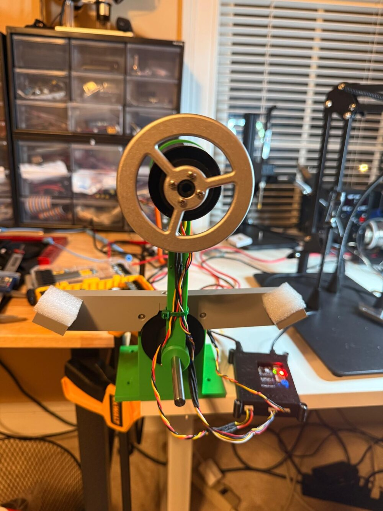</td>
<td><a href="media/balancing.mp4">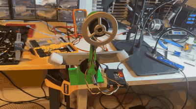</a></td>
</tr>
<tr>
<td><em>The finished pendulum. Green printed stand and pivot block, grey stop arch with foam pads, 4015 motor and 80&nbsp;mm flywheel on top, ESC in its box at the right.</em></td>
<td><em>Balancing upright on its own (click for the full-quality video, <code>media/balancing.mp4</code>).</em></td>
</tr>
</table>

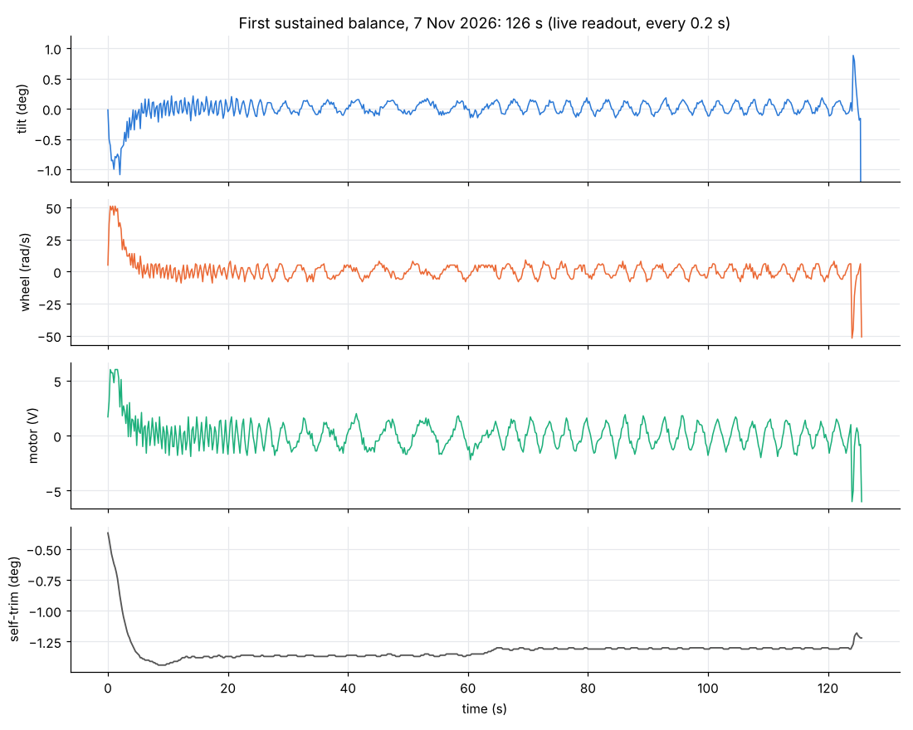

*7 Nov 2026, firmware v3.6. Tilt stays within about ±0.15° (0.27° rms over the whole run), the wheel within ±8 rad/s, and the motor near 1.3 V rms. The bottom panel is the controller finding its own balance point: it settled 1.30° from the value it started with. It recovered from one tap at about 124 s; the second, harder push ended the run.*

---

## 1. The system at a glance

```
 ┌─────────────────────┐   12 V (3 A limit)   ┌───────────────────────────────────────────────┐
 │  Bench supply       ├─────barrel jack─────►│  B-G431B-ESC1  (STM32G431 @ 170 MHz)          │
 └─────────────────────┘                      │                                               │
                                              │  6 × PWM, 3-phase bridge ──────────────┐      │
 ┌─────────────────────┐   USB (ST-LINK)      │  VBUS sense: PA0, 169k/18k divider     │      │
 │  PC                 │◄────────────────────►│  TIM2 PWM-input capture: PA15 ◄──┐     │      │
 │  Serial 115200      │   commands, live     │  Encoder A/B: PB6/PB7 ◄───┐      │     │      │
 │  sysid.py, plots    │   line, CSV dumps    └───────────────────────────┼──────┼─────┼──────┘
 └─────────────────────┘                                     J8 (5-pin)   │   J3 │(3)  │ phases
                                                                          │      │     ▼
        on the swinging bar ───────────────────────────────────────────┐  │      │  ┌──────────────┐
        │  MT6701 encoder (ABZ, 1024 PPR → 4096 counts/rev) ───────────┼──┘      │  │ 4015 gimbal  │
        │  measures the WHEEL angle relative to the bar                │         │  │ motor, 11 pp │
        │                                                              │         │  │ + 80 mm      │
        │  motor + flywheel at the top of the 150 mm bar ◄─────────────┼─────────┼──┤   flywheel   │
        └──────────────────────────────────────────────────────────────┘         │  └──────────────┘
                                                                                 │
        on the stand ────────────────────────────────────────────────────┐       │
        │  AS5048A magnetic sensor facing a magnet on the pivot shaft    ├───────┘
        │  measures the BAR angle (PWM output, 14-bit)                   │
        └────────────────────────────────────────────────────────────────┘
```

| Subsystem | What it is |
|---|---|
| Plant | 150 mm printed bar on a pivot shaft in two 608 bearings; 4015 gimbal motor and 80 mm flywheel at the top |
| Actuator | The motor in SimpleFOC voltage-torque mode. The command is a q-axis voltage, ±6 V at 12 V supply |
| Tilt sensor | AS5048A on the stand, PWM output (4119 clocks per frame), timed by TIM2 hardware |
| Wheel sensor | MT6701 incremental encoder on the motor, read by pin interrupts |
| Controller | 1 kHz loop on the ESC's STM32G431: momentum observer, discrete LQR, slew limit, self-trim |
| Tools | `sysid.py` (record and fit), `design.py` / `design2.py` (LQR and observer), `simulate.py` (nonlinear sim) |

---

## 2. Mechanics

All the printed parts are parametric OpenSCAD files in `rotor_parts/`.

### 2.1 Pivot block (v5)

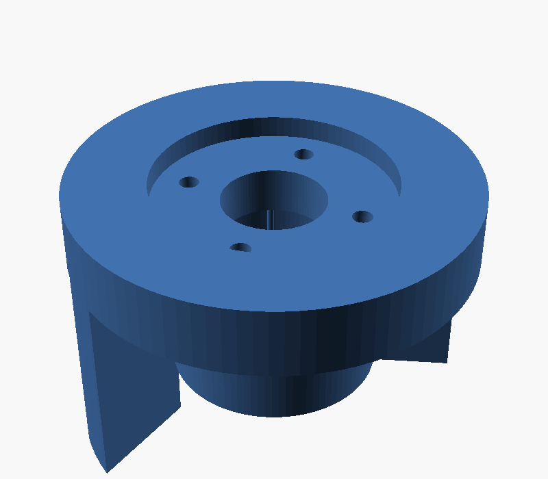

The block holds the two 608 bearings that carry the pivot shaft, and bolts to the green upright of the stand.

- **Crush ribs** in the bearing bores. The early falls knocked the bearings and the shaft clean out of the block; small ribs that the bearing shaves on the way in give a press fit that doesn't depend on the printer's hole accuracy. A drop of CA glue finishes the job.
- **Boss recess**, 34.6 mm × 3.2 mm in the back face, so the flange sits flat against the stand's collar instead of standing 2 mm off it. A separate shim (`pivot_shim.scad`) does the same job for blocks printed before the recess.
- **Elephant-foot chamfers** on the bed-side edges so the first layer doesn't spoil the fit.
- The block's own hard-stop ribs are switched off (`RIBS = false`). Why is the next section.

### 2.2 Stop arch: catching the bar in the right place

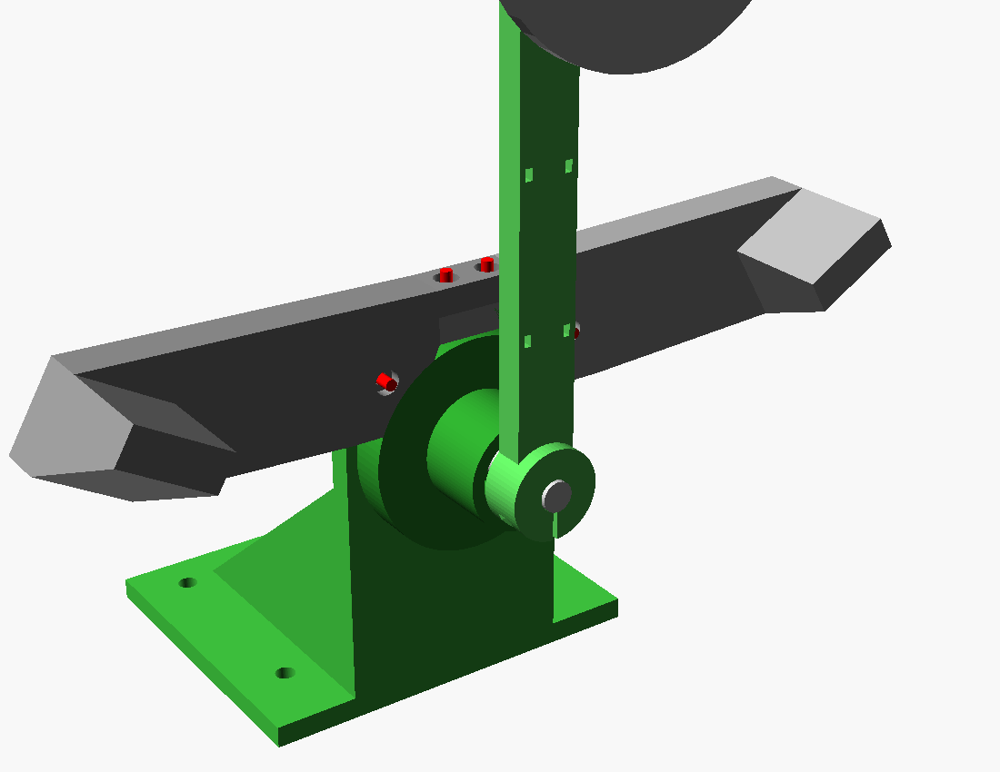

The first hard stop was a 6 mm post next to the pivot. A fall snapped it off. Its replacement, ribs on the pivot block, kept knocking the bearings out. Both failures have the same cause, and it comes straight out of the identified λ.

When a swinging bar is stopped by an impulse P at distance r from the pivot, the bearings feel an impulse

$$R = m\,l\,\omega\left(1 - \frac{l_{eq}}{r}\right), \qquad l_{eq} = \frac{J}{m\,l} = \frac{g}{\lambda^2} \approx 146\ \text{mm}$$

l_eq is the **centre of percussion**, the length of the simple pendulum that swings at the same rate. Catch the bar there and the bearings feel nothing. Catch it near the pivot and the bearings take a multiple of the bar's momentum:

| Where the stop catches | R / (m l ω) | Force on the stop itself |
|---|---:|---|
| Old ribs, ~20 mm out | ≈ 6.5 (wrong direction, pries the bearings out) | high |
| Arch pads, 88–114 mm out | ≈ 0.5 | about 5× lower |
| 146 mm (centre of percussion) | 0 | lowest |

The arch is two printed halves that lap over the top of the upright (2 × M3 vertical) and bolt to its front face (1 × M3 each). Pads reach forward into the bar's plane and catch its edge at 60° from upright. They sit 88–114 mm along the bar, which clears the cable ties at 80 and 120 mm. Each pad gets 2–3 mm of foam tape. The arch comes off for hanging tests.

### 2.3 Wheel adapter (v3)

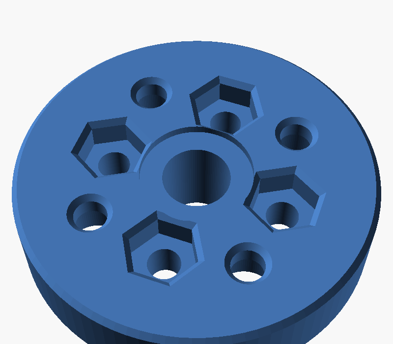

The flywheel wobbled visibly at 8 rad/s because only two of its four screws would go in, and the adapter sat on a raised edge. Adapter v3 has a recess that centres the flywheel and four clearance holes. In the end the old adapter was fixed in place: the nuts were superglued in, the holes opened up, and the spacer sat flat. Wobble at 16 rad/s became negligible.

### 2.4 ESC enclosure (v3)

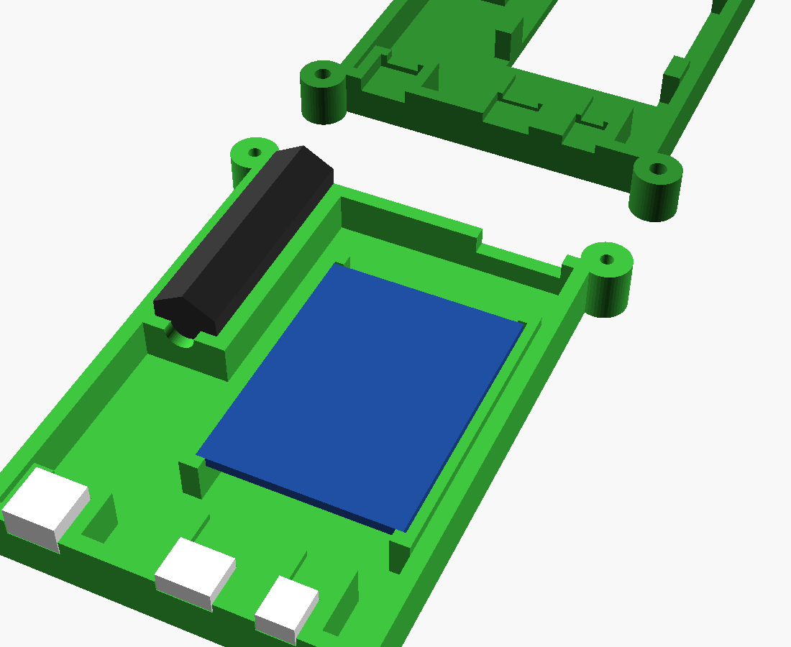

The rule for this box: every cable leaves through a connector held **in the wall**, so a tug on a cable pulls on the box, never on the solder pads.

- **Signal wall:** white 3-pin motor phase connector (8 × 4.75 mm), MX1.25 5-pin (ENC), MX1.25 3-pin (TILT).
- **Power wall:** the barrel jack (10 mm hex, 38 mm long) in a channel along the side with its mouth flush, plus the micro-USB opening.
- **Split plane at the board's top face.** Every outlet sits on it, so the base holds the lower half of each connector and the lid clamps the upper half. Four lid fingers press the board onto its ledges.
- A 4.5 mm gutter runs the full length so wires from the far end of the board can reach the signal wall.
- The lid has a window over the whole board: LEDs, pot and button stay reachable and the MOSFETs breathe.

### 2.5 Cable routing (the final fix)

Eight wires leave the moving bar: three thick motor phases and five thin encoder wires. They turned out to matter more than anything else on this list (section 7, step 7). What works:

- Twist the phase wires together, and twist the three AS5048A wires.
- Phase wires leave the shaft to the **left**, encoder wires to the **right**, so their stiffness pulls in opposite directions and largely cancels.
- Check that the bar, with the motor off, rotates freely through upright with no preferred position.

---

## 3. Electronics and pinout

| Connector | Pins | Goes to |
|---|---|---|
| J8 (5-pin, MX1.25 at the box) | A → PB6, B → PB7, Z, 5 V, GND | MT6701 wheel encoder |
| J3 (3-pin, MX1.25 at the box) | GND, PWM → PA15, 5 V | AS5048A tilt sensor |
| Phases | U, V, W | 4015 motor (white 3-pin) |
| Barrel jack | 12 V | bench supply, current limit 3 A |
| Micro-USB | ST-LINK + virtual serial | PC, 115200 baud |
| On-board | PA0 = VBUS (169k/18k divider), PB12 = pot, PC10 = button | |

Things learned the hard way:

- **MX1.25 crimps are finicky.** The TILT connector once had 5 V on the male side and none through the mated pair. Reseating the terminals fixed it. A flaky contact shows up as an angle that changes when you touch the connector.
- **The supply limit matters.** A ±6 V step from standstill draws about 2.5 A. The supply ran at 1 A at first; it now runs at 3 A. VBUS, logged every 1 ms, stays at 12.0 V.
- **The pot reads full scale** on this board, so the gain is set from the keyboard (`G0.85`).

---

## 4. Firmware

Two sketches, both on SimpleFOC 2.4.0 and STM32 core 2.12.0, flashed over SWD.

### 4.1 `esc1_sysid.ino`: the identification rig

Records the tilt and the wheel at 5 ms and streams CSV to `sysid.py`.

| Command (in `sysid.py`) | Test |
|---|---|
| `rec H` | Hanging, at rest: sensor noise and the hanging zero |
| `rec S` | Swing: lift the bar ~30°, release, motor off, record the free decay |
| `rec K` | Kick: hanging, a voltage step into the motor; bar and wheel both respond |
| `rec U<v>` | Hold a steady voltage: wheel top speed per volt |
| `fit` | Fit the nonlinear model to every recording, write `model.txt`, plot |

### 4.2 `esc1_balance.ino` v3.6: the balance controller

One 1 ms step:

1. Read the tilt from TIM2 (section 4.3) and the wheel speed from the encoder.
2. Run the momentum observer (section 6.1) to get the tilt and the tilt rate.
3. Compute the LQR command, clip to ±U_MAX, slew-limit to 0.3 V per step.
4. Update the balance-point trim from the wheel speed (section 6.4).
5. Check the stop conditions.

The observer and control code, as it runs:

```cpp
thdH = (pH - R_I*wM)/(1+R_I);                    // tilt rate from momentum and wheel speed
thP  = thH + TS*thdH;                            // predict
pP   = pH  + TS*(LAM2*sinf(thP) - C_V*thdH);
e = wrapPi(thM - thP);                           // innovation
if (!ok || (fabsf(e) > GATE && rej < 20)) { rej++; e = 0; } else rej = 0;
thH = thP + L0*e;  pH = pP + L1*e;               // correct
thdH = (pH - R_I*wM)/(1+R_I);
uNew = -g*(K0*thH + K1*thdH + K2*wM);            // LQR
uNew = constrain(uNew, -U_MAX, U_MAX);
u += constrain(uNew - u, -SLEW, SLEW);           // slew limit
```

**Commands** (Serial, 115200, newline):

| Cmd | Does |
|---|---|
| `A` / `X` (or the button) | Arm / stop. When armed, it takes over once the bar is within 1° of balance for 0.3 s |
| `G<x>` | Fixed gain multiplier (default 0.85). `G` alone returns to the knob (0.6–1.2) |
| `U<v>` | Motor voltage limit (default 6 V) |
| `Z` | Balance point = here (hold it balanced, motor off). Also clears the trim |
| `T<deg>` | Set the trim directly. `+` / `-` nudge it by 0.05° |
| `L` | Live readout on/off |
| `P` | Dump the last 2 s as CSV: `t_ms, theta_deg, theta_raw_deg, wheel_rad_s, u_V, vbus_V` |
| `I` | Recalibrate the motor |

**Stops:** tilt past 25°; motor at the voltage limit for 1 s; wheel above 75 rad/s for 20 ms; no tilt reading for 20 ms.

The live line is short (fits the serial buffer) and only goes out every 200 ms while balancing, because a long one stalled the loop for 6 ms (section 7, step 5).

### 4.3 Reading the AS5048A with a timer, not an interrupt

The AS5048A encodes the angle as the duty cycle of a ~1 kHz PWM frame of 4119 clocks. The first version timed the edges in an interrupt with the cycle counter. That works at rest, but with the wheel spinning at 50 rad/s the encoder fires ~33,000 interrupts a second, each able to delay the tilt interrupt by a microsecond or two, and 1 µs of the frame is 0.35°.

TIM2 in **PWM-input mode** latches both edges in hardware, so software latency doesn't matter. Its digital input filter also throws away glitches shorter than 0.75 µs.

```cpp
// PA15 = TIM2_CH1 (AF1). CH1 captures the period (rising), CH2 the high time (falling); reset on each rise.
TIM2->CCMR1 = (1u << TIM_CCMR1_CC1S_Pos) | (2u << TIM_CCMR1_CC2S_Pos) | (0xCu << TIM_CCMR1_IC1F_Pos);
TIM2->CCER  = TIM_CCER_CC1E | TIM_CCER_CC2E | TIM_CCER_CC2P;
TIM2->SMCR  = (5u << TIM_SMCR_TS_Pos) | (4u << TIM_SMCR_SMS_Pos);   // trigger TI1FP1, reset mode
// angle: counts = CCR2 / CCR1 * 4119 - 16  (0..4095)
```

---

## 5. System identification

This was the most rewarding part. The full derivation, with s-plane and z-plane pictures, is in the companion note *Reading poles from a swing* (`pendulum_poles.md`). The summary:

### 5.1 The model

With the wheel speed ψ̇ relative to the bar, the bar angle θ from upright, and the motor voltage u:

$$\ddot\theta = \lambda^2 \sin\theta - c\,\dot\theta - f_c\,\mathrm{sign}(\dot\theta) - r\,\ddot\psi_{abs}, \qquad r = \frac{I_w}{J}$$

The motor turns a voltage into a wheel speed with a first-order lag and a top speed of (a/b) per volt.

### 5.2 Swing tests: λ

Hanging, the poles are ±jλ and the bar swings at about λ rad/s. The nonlinear fit (sin θ, viscous plus Coulomb friction) matches the swing to 0.14° rms.

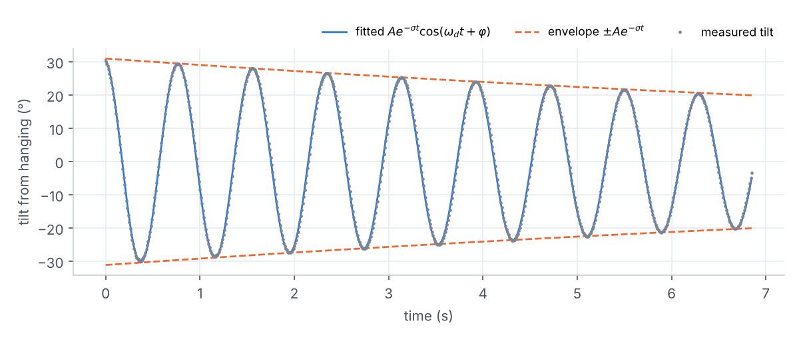

$$\lambda = 8.207\ \text{rad/s}, \qquad \frac{1}{\lambda} = 122\ \text{ms}, \qquad t_{double} = \frac{\ln 2}{\lambda} = 84\ \text{ms}$$

Standing up flips the sign of gravity and turns ±jλ into ±λ. The pole at +λ is the fall: a lean doubles every 84 ms.

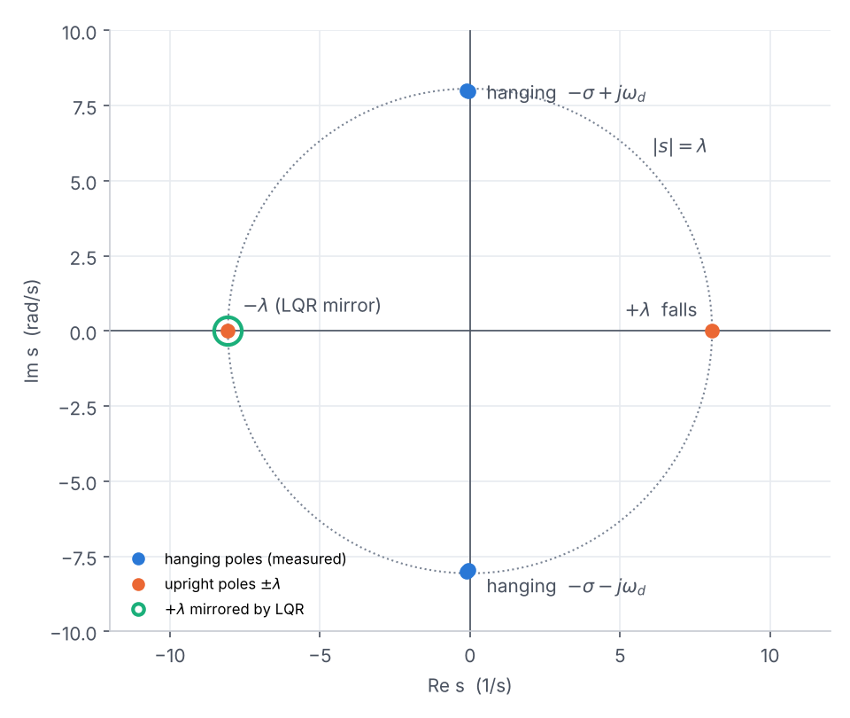

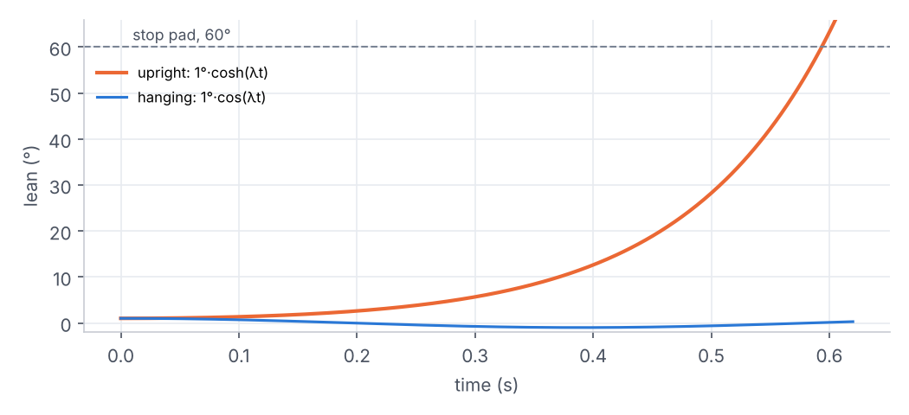

Two things the fits revealed that a textbook linear fit misses:

- **Frequency depends on amplitude**, ω(A) ≈ λ(1 − A²/16). A ±30° swing runs slow, so a linear fit reads λ low.
- **The damping is mostly dry friction**: the swing envelope is a straight line, not an exponential.

### 5.3 Kick tests: the wheel

A voltage step into the motor, with the bar hanging, spins the wheel up and kicks the bar the other way. From these:

| Parameter | Value | Note |
|---|---|---|
| r = I_w / J | 0.01173 | Ratio of wheel inertia to bar inertia |
| a/b (top speed per volt) | 8.82 rad/s per V | 53 rad/s at 6 V |
| a and b separately | **not identifiable** | The motor's time constant is shorter than the 5 ms sample |

The last line was a real lesson. The fit happily returned a and b, but any pair with the same ratio fit equally well. Only the combinations that the data actually excite (a/b and r) can be trusted, and the controller had to be built so it didn't depend on the rest (section 6.1).

### 5.4 Fitting fast data

A side lesson from the z-plane analysis: fitting a difference equation by least squares at 5 ms gives σ about 50× too large, because with the poles that close to z = 1 the regressors are mostly noise (errors-in-variables bias). Decimating to 20–80 ms, or fitting in continuous time as `sysid.py` does, gives the right answer.

---

## 6. Control design

### 6.1 Momentum observer

The first observer, a Kalman filter on the full model, needed the motor's a and b. With a fast motor (which the data couldn't rule out) it went unstable. The fix was to estimate a quantity that doesn't involve the motor at all: the **total angular momentum about the pivot**, per unit J,

$$p = (1 + r)\,\dot\theta + r\,\dot\psi$$

The motor's torque is internal to the bar-plus-wheel system, so only gravity and friction change p:

$$\dot p = \lambda^2 \sin\theta - c\,\dot\theta$$

The observer predicts θ and p, corrects them with the tilt reading, and recovers the tilt rate from p and the measured wheel speed. Gains L = [0.1014, 5.480] (tuned with process noise q_p = 3, deliberately slow; see section 7, step 4).

**Innovation gate:** a tilt reading more than 1° from the prediction is discarded. After 20 in a row it accepts them again, so a real disturbance can't lock the observer out.

### 6.2 Discrete LQR

Designed at Ts = 1 ms on the linearised plant, with state [θ, θ̇, ψ̇]:

$$u = -g\,(K_0\,\theta + K_1\,\dot\theta + K_2\,\dot\psi), \qquad K = [-182.17,\ -21.14,\ -0.2273]$$

in V/rad, V/(rad/s), V/(rad/s). The multiplier g defaults to 0.85.

LQR's classical guarantee is a gain margin of [0.5, ∞). On the real loop, with a few ms of sensor delay, g above about 1.2 chatters bang-bang, and below 0.5 it can't hold the bar.

### 6.3 Slew limit

The motor voltage may change by at most 0.3 V per 1 ms step. This removes the sharp steps that disturbed the tilt reading (section 7, step 4).

### 6.4 Self-trim of the balance point

If the zero is off by δ, the only way to hold the bar at a lean is a steady wheel acceleration, so the wheel speed ramps. So the controller moves its zero against the wheel speed:

$$\text{trim} \mathrel{-}= K_{trim}\,\dot\psi\,\Delta t, \qquad K_{trim} = 2\times10^{-4}$$

It runs only while the motor isn't saturated. In the 126 s run it moved the zero 1.30° in the first 10 s and then held.

### 6.5 Saturation

At 12 V the wheel can't exceed 8.8 × 6 = 53 rad/s. Once it is there, the motor can't accelerate it further, so it can't push the bar: the controller has lost all authority. A balance point 1.2° off is enough to drive the wheel there at 6 V (0.8° at 3.5 V), which is why the self-trim and a correct zero matter so much.

---

## 7. Simulation

`simulate.py` runs the closed loop against a model meant to be worse than the real thing:

- nonlinear plant (sin θ), dry and viscous friction;
- sensor delay, noise, and random spikes;
- the voltage-step effect on the tilt reading;
- a cable spring;
- slew limit, voltage limit, self-trim.

`plot_sim.py` drives it from the command line (`offset=`, `start=`, `tap=`, `gain=`, `tau=`).

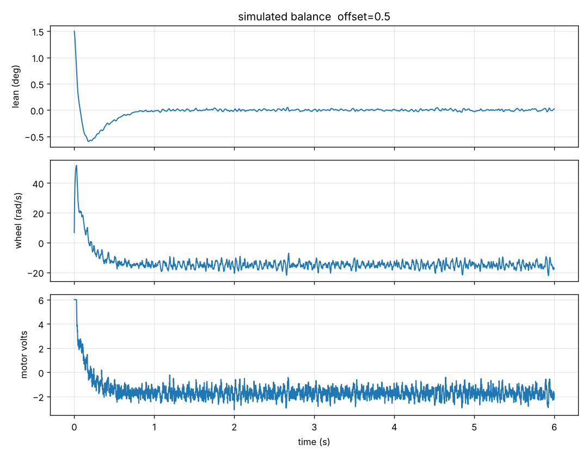

Its value was diagnostic: every failure on the bench was reproduced in the simulation before it was fixed, so each fix was tested before it was flashed.

---

## 8. The debugging journey

In the order they were found. Each one hid the next.

| # | Symptom | Diagnosis | Fix |
|---|---|---|---|
| 1 | Raw tilt jumps ±1–2° every sample once the wheel spins | Interrupt-timed PWM disturbed by encoder interrupts | TIM2 hardware capture (v3) |
| 2 | Tilt glitches whenever the motor kicks hard | Suspected 1 A supply limit browning out the sensor | Supply to 3 A; VBUS logged. VBUS stayed at 12.0 V, so this wasn't it |
| 3 | Angle shifted when the shaft was touched | Magnet touching the sensor | Shaft pulled back 1 mm |
| 4 | Self-sustaining ~40 Hz bang-bang chatter | Each voltage step makes the tilt reading dip the opposite way for ~10 ms (≈0.6°/V); the controller answers the dip with another step | Slew limit 0.3 V/ms and a slower observer (v3.4) |
| 5 | Wheel-speed spikes of −180 rad/s exactly every 100 ms | The live print blocked the loop for 6 ms | Short line every 200 ms, only if the buffer has room (v3.5) |
| 6 | Wheel drifts steadily to its speed limit | Balance point several degrees off: hanging + 180° was wrong by ~4° | `Z` at the spot where it stands by itself, plus self-trim |
| 7 | Still drifts; with the motor pinned at +6 V and the wheel at top speed, the bar *still* stands | The cable bundle, all on one side, held the bar near upright, so leaning couldn't unload the wheel | Phase wires left, encoder wires right (v3.6). **126 s balance** |

Selected evidence:

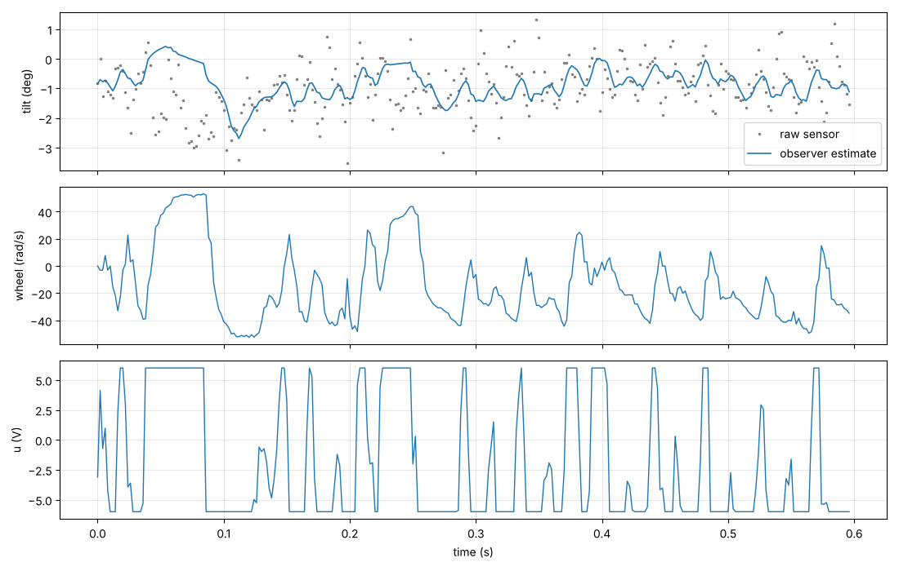

*Step 1. Grey dots: raw tilt with the wheel spinning. Scatter of ±1–2° around the estimate.*

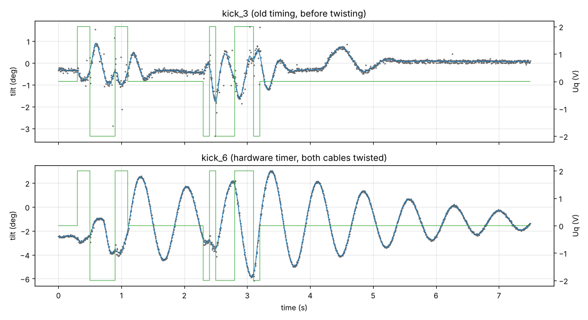

*The same kick test before (top: interrupt timing, untwisted cables) and after (bottom: TIM2 capture, both cables twisted). The scattered points are gone and the fit sits on the data.*

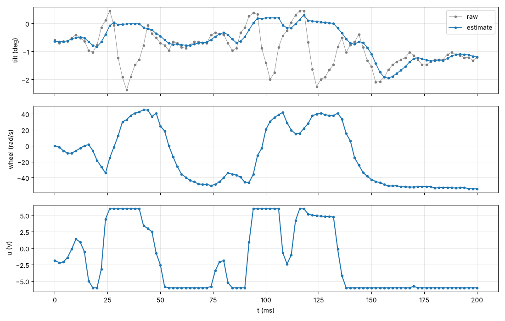

*Step 4. The raw tilt (grey) dips sharply after each large voltage step and recovers in ~10 ms.*

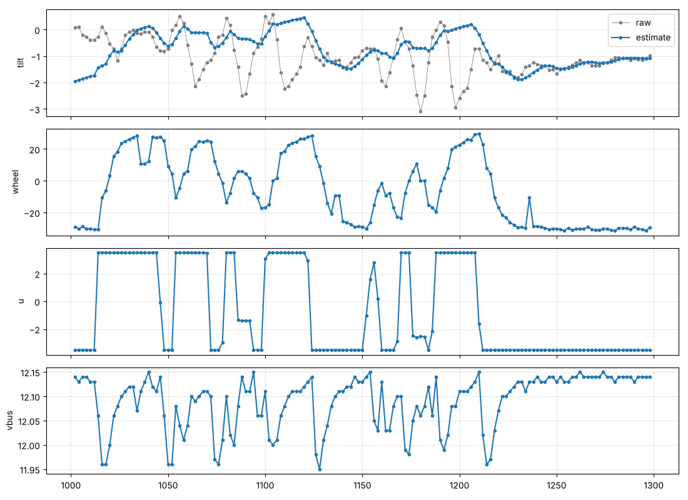

*Step 2. VBUS at 1 ms resolution. It doesn't sag, so the dips are not a brownout.*

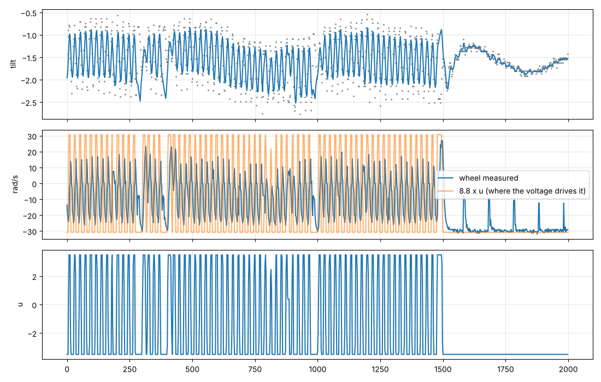

*Step 4. The chatter: the voltage slams between the limits and the wheel follows. Here the limit was 3.5 V, and at 1.5 s the wheel saturates at −30 rad/s.*

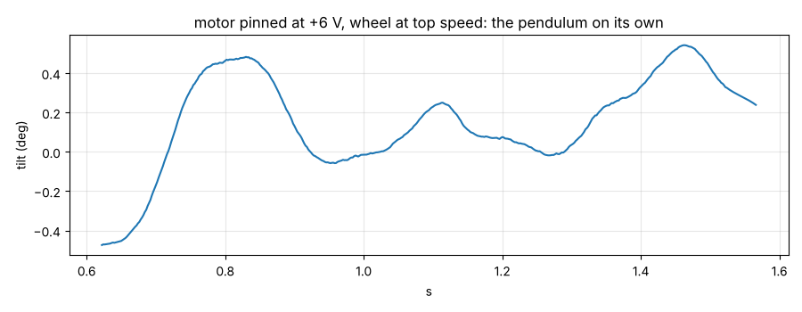

*Step 7, the clue. The motor is pinned at +6 V and the wheel is at top speed, so the controller has no authority, yet the bar wanders within ±0.5° instead of falling. Something other than the wheel was holding it: the cables.*

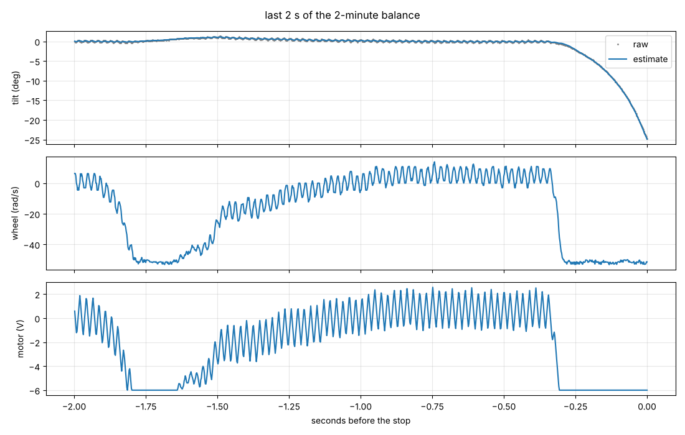

*The end of the good run. The first tap (at −1.85 s) drives the wheel to its 53 rad/s limit for 150 ms, and the controller still recovers. The second push (−0.32 s) saturates it again with the bar already leaning, and with no authority left the bar falls on the λ curve.*

---

## 9. Results

| Metric | Value |
|---|---|
| Longest balance | 126 s (ended by a deliberate push) |
| Tilt | within about ±0.15° most of the time, 0.27° rms over the whole run |
| Wheel speed | within ±8 rad/s (limit 53) |
| Motor voltage | ~1.3 V rms (limit 6) |
| Self-trim | settled at −1.30° in ~10 s |
| Disturbance | recovered from one tap; fell on a second, bigger push |

Settings for that run: v3.6, g = 0.85, U_MAX = 6 V, 12 V supply at 3 A, UPRIGHT_RAW = 29.82° (the final balance point, already including the trim).

---

## 10. How to run it

1. Arch on, foam on the pads. 12 V first, then USB. Serial at 115200, newline.
2. The sketch prints `# esc1_balance v3.6` and calibrates the motor. Let the bar rest on a pad meanwhile.
3. Send `A` (or press the button). Status says "waiting".
4. Lift the bar slowly to upright and hold it lightly. Within 1° for 0.3 s, the controller takes over: you feel the wheel push. Let go.
5. Send `X` to stop. After a fall, `P` dumps the last 2 s.
6. If cables have been re-routed, re-find the balance point: hold it where it stands by itself and send `Z`, then let the self-trim finish the job and copy its value into `UPRIGHT_RAW`.

---

## 11. Next steps

- **Push tolerance.** More supply voltage raises the wheel's top speed and the available torque. At 19 V the identified model stays the same, but the voltage limit, the slew limit and the stop thresholds need re-checking in simulation first.
- **Closed-loop identification.** With the bar balanced, a small known excitation added to u would identify the motor's lag directly, the one parameter the hanging tests couldn't see.
- **The knob.** Find out why PB12 reads full scale and restore the live gain knob.
- **A swing-up** from hanging, using the wheel to pump energy in.

---

## 12. File index

| File | Contents |
|---|---|
| `code/esc1_balance/esc1_balance.ino` | Balance controller v3.6; version history in its header |
| `code/esc1_balance/design.py`, `design2.py` | Plant model, discrete LQR, momentum-observer gains, robustness checks |
| `code/esc1_balance/simulate.py`, `plot_sim.py` | Nonlinear closed-loop simulation and its command-line front end |
| `code/esc1_sysid/esc1_sysid.ino` | Identification sketch (TIM2 capture) |
| `code/esc1_sysid/sysid.py` | Record, fit, plot |
| `cad/*.scad`, `cad/*.stl` | Pivot block v5, spacer, shim, stop arch (left and right), ESC box v3 (base and lid), wheel adapter v3, assembly |
| `pendulum_poles.md` | Companion note: reading poles from a swing |
| `media/` | Photo, balancing video (mp4) and its GIF preview |

### Key numbers

| Symbol | Value |
|---|---|
| λ | 8.207 rad/s (λ² = 67.35 s⁻²) |
| Doubling time upright | 84 ms |
| Centre of percussion g/λ² | 146 mm |
| r = I_w/J | 0.01173 |
| Wheel top speed | 8.82 rad/s per V |
| Pivot viscous friction c | 0.12 s⁻¹ |
| K (Ts = 1 ms) | [−182.17, −21.14, −0.2273] |
| L (observer) | [0.1014, 5.480] |
| Slew, gate, trim rate | 0.3 V/ms, 1°, 2×10⁻⁴ |
