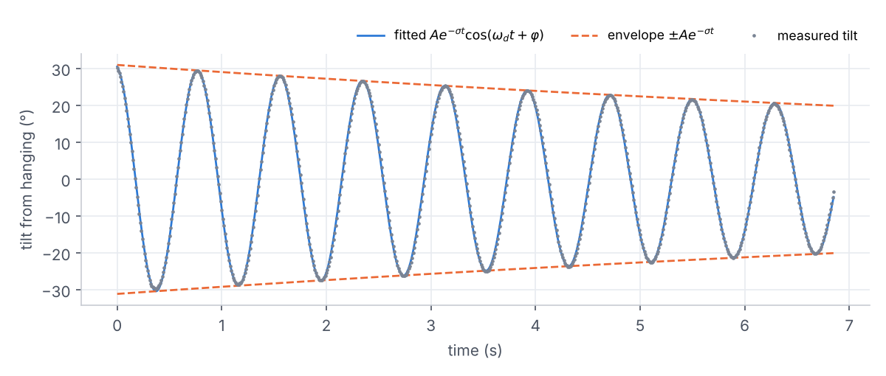
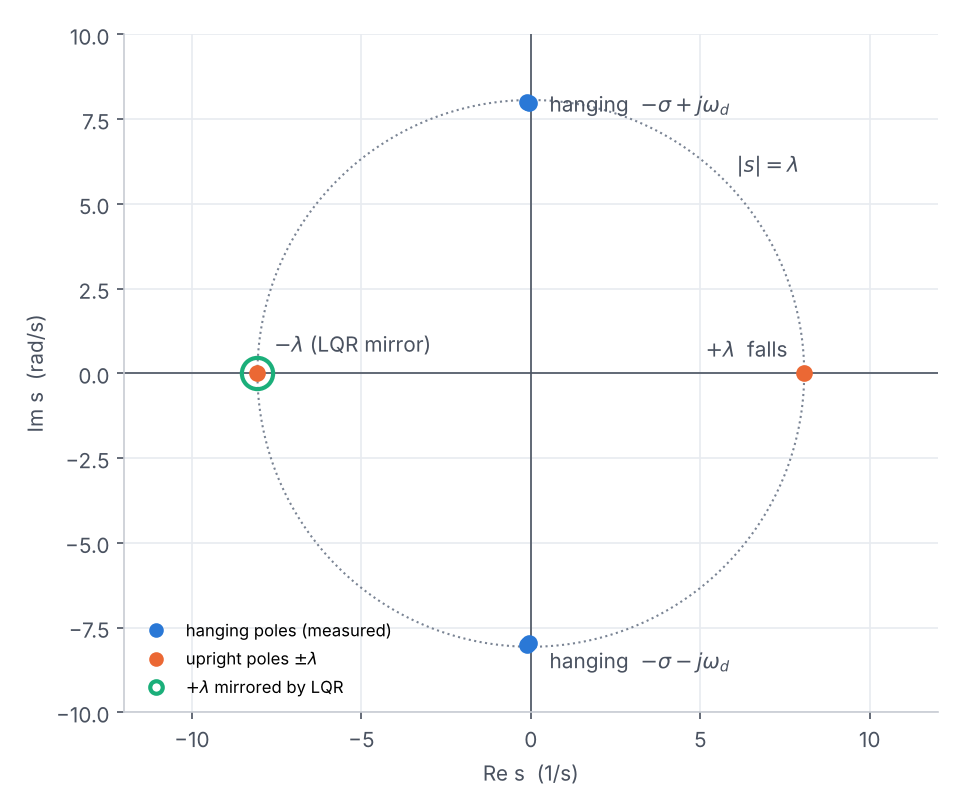
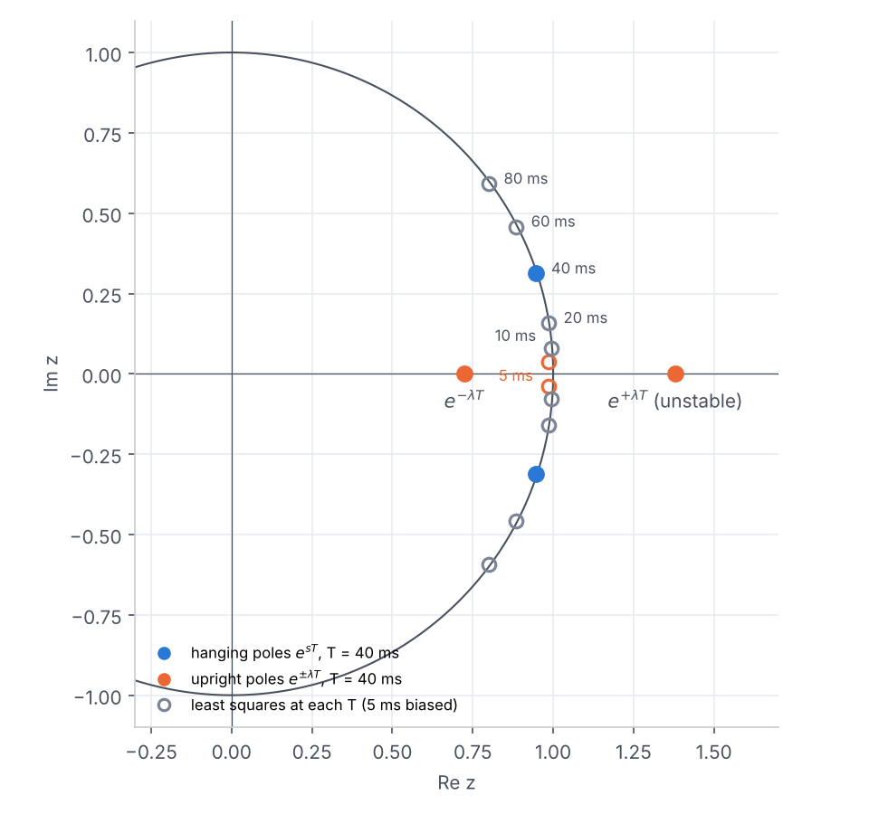
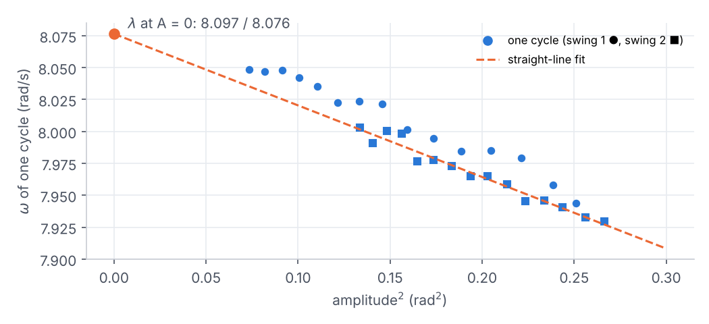
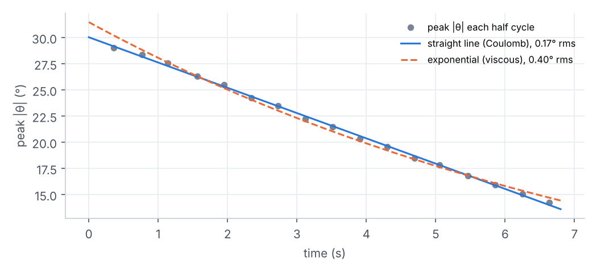
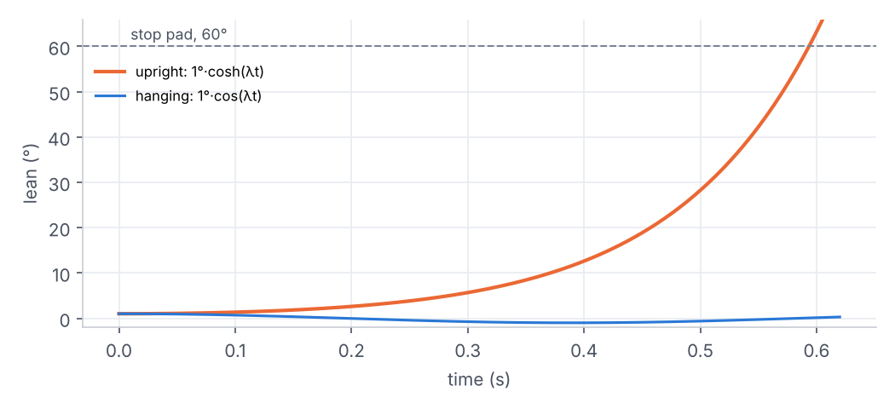

# Reading poles from a swing

*Reaction-wheel pendulum: system identification notebook*

This note shows how two recordings of the pendulum hanging and swinging (motor off, AS5048A sampled every 5 ms) give the poles that decide how it falls when it stands up. The same data is worked three ways:

- in continuous time (s-plane);
- in discrete time (z-plane);
- back in the time domain.

The data is Wednesday's `swing_1.csv` and `swing_2.csv`.

---

## 1. The data, and the model it should obey

Hanging, with the motor off and the wheel free, the pendulum is a plain oscillator. For small angles the physics and the textbook second-order system are the same equation:

$$\ddot\theta + 2\zeta\omega_n\,\dot\theta + \omega_n^2\,\theta = 0 \quad\Leftrightarrow\quad s^2 + 2\sigma s + \omega_n^2 = 0 \quad\Rightarrow\quad s = -\sigma \pm j\omega_d$$

where

$$\sigma = \zeta\omega_n,\qquad \omega_d = \omega_n\sqrt{1-\zeta^2},\qquad \omega_n^2 = \frac{mgl}{J} = \lambda^2$$

The free response of that system is a decaying sinusoid:

$$\theta(t) = A\,e^{-\sigma t}\cos(\omega_d t + \varphi)$$

Each part of the curve gives one coordinate of the pole:

- **Real part σ:** how fast the envelope shrinks.
- **Imaginary part ω_d:** how fast the swing oscillates.

So fitting the curve is reading the pole.

*Swing 2, released from about 31°. The fit stays in phase for all nine cycles.*

| Quantity | Swing 1 | Swing 2 |
|---|---:|---:|
| σ (decay rate) | 0.112 1/s | 0.064 1/s |
| ω_d (ringing frequency) | 8.005 rad/s | 7.966 rad/s |
| ζ (damping ratio) | 0.0140 | 0.0081 |
| fit error | 0.56° rms | 0.46° rms |

---

## 2. s-plane: from the fit to the poles

The fit gives $s = -0.064 \pm j\,7.966$ for swing 2.

- **Where they sit:** in the s-plane the hanging poles sit almost on the imaginary axis.
- **What ζ ≈ 0.008 means:** the pendulum loses less than 5% of its amplitude per cycle.
- **Distance from the origin:** ω_n.

Stand the pendulum up and gravity's sign flips. With φ = θ − π, sin(φ + π) = −sin φ, so the characteristic equation becomes

$$s^2 - \lambda^2 = 0 \quad\Rightarrow\quad s = \pm\lambda$$

The same magnitude is now on the real axis. The pole at **+λ is the fall**.

*Both axes use the same scale, so the circle of radius λ is round. Turning the pendulum upright rotates its poles 90° around the origin, from ±jλ to ±λ. The green ring is +λ mirrored to −λ, the slowest that a stabilising LQR will leave it.*

---

## 3. z-plane: the same poles from the samples alone

The controller will run in discrete time, so the identification can also be done there, with no curve fitting at all. Sampled every T seconds, a second-order system obeys a two-term recursion. Its coefficients come from one linear least-squares solve over the samples:

$$y[k] = a_1\,y[k-1] + a_2\,y[k-2] \quad\Rightarrow\quad z^2 - a_1 z - a_2 = 0 \quad\Rightarrow\quad s = \frac{\ln z}{T}$$

The last step uses $z = e^{sT}$. That mapping wraps the s-plane around the unit circle:

- **|z| = e^{−σT}:** the decay per sample.
- **arg z = ω_d T:** the angle turned per sample.
- **Left half of the s-plane:** lands inside the circle.
- **Right half:** lands outside.

*Filled dots are the model poles at T = 40 ms. Open circles are the least-squares fits at each sample period.*

The upright pair sits on the real axis, one outside the circle (unstable) and one inside. At the balance loop's 1 ms rate every pole crowds next to z = 1, and the upright pair is

$$e^{\pm\lambda\cdot 1\,\text{ms}} = 1.0081 \;\text{and}\; 0.9920$$

| T (ms) | z (least squares) | \|z\| | σ = −ln\|z\|/T | ω_d = arg z / T |
|---:|---|---:|---:|---:|
| **5** | **0.9844 ± j0.0371** | **0.98508** | **3.006** | **7.535** |
| 10 | 0.9936 ± j0.0792 | 0.99680 | 0.320 | 7.959 |
| 20 | 0.9852 ± j0.1583 | 0.99780 | 0.110 | 7.967 |
| 40 | 0.9470 ± j0.3123 | 0.99719 | 0.070 | 7.963 |
| 60 | 0.8844 ± j0.4581 | 0.99601 | 0.067 | 7.965 |
| 80 | 0.7996 ± j0.5917 | 0.99470 | 0.066 | 7.963 |
| continuous fit | — | — | 0.064 | 7.966 |

> **At T = 5 ms the least-squares answer is badly wrong:** σ comes out about 50 times too large.
>
> - **Why:** with the poles that close to z = 1, the recursion mostly measures the second difference of the signal. That difference is tiny compared with the 0.01° sensor resolution and noise.
> - **The effect:** noise in the regressors biases ordinary least squares toward the origin (the errors-in-variables problem).
> - **The fix:** decimating to 20–80 ms opens up the angle per sample, and the answer matches the continuous fit.
>
> Sampling fast is good for control but bad for this kind of identification. Fast data is better fitted in continuous time, which is what `sysid.py` does.

---

## 4. What a linear fit cannot see

The linear fits above give ω_n ≈ 7.97, but `sysid.py` reported λ = 8.07. The difference is real. The true equation has sin θ, not θ, and a pendulum swinging ±30° runs slow. To first order:

$$\omega(A) \approx \lambda\left(1 - \frac{A^2}{16}\right)$$

Timing each cycle from its zero crossings and plotting its frequency against amplitude² shows this directly:

*As the swing dies down the pendulum speeds up. The value at zero amplitude is the small-angle λ: 8.097 and 8.076 rad/s for the two swings, matching the nonlinear fit. The measured slope is close to theory's −λ/16.*

The envelope also shows something the linear model can't:

- **Viscous damping (σ)** shrinks the amplitude by a constant ratio per cycle, which gives an **exponential** envelope.
- **Dry friction** in the bearings removes a constant amount per cycle, which gives a **straight line**.

Over a short decay the two look alike, so the chart uses swing 1, which decayed from 29° to 14°. There the straight line fits the peaks more than twice as well (0.17° rms against 0.40°), so most of the damping is dry friction.

*Swing 1. Peaks alternate slightly high and low because the swing isn't perfectly centred. The exponential bows away from the data at both ends; the straight line doesn't.*

Both effects, the amplitude-dependent frequency and the shape of the friction, are why `sysid.py` fits the nonlinear equation

$$\ddot\theta = -\lambda^2\sin\theta - c\,\dot\theta - f_c\,\mathrm{sign}(\dot\theta)$$

instead of a decaying sinusoid. On swing 2 its error is 0.14° rms, against the sinusoid's 0.46°.

---

## 5. Back to the time domain, upright

With poles at ±λ, a lean released at rest from φ₀ evolves as

$$\varphi(t) = \varphi_0\cosh(\lambda t) = \frac{\varphi_0}{2}\left(e^{\lambda t} + e^{-\lambda t}\right)$$

The $e^{-\lambda t}$ part dies out almost at once. The $e^{+\lambda t}$ part grows by a factor of e every $1/\lambda$ = **124 ms** and doubles every $\ln 2/\lambda$ = **86 ms**. Hanging, the same start gives $\varphi_0\cos(\lambda t)$, which stays bounded forever.

*Both curves start from a 1° lean at rest. Upright, the lean reaches 10° in about 0.37 s and the 60° pad in about 0.6 s. Hanging, it never leaves ±1°.*

That is the controller's whole problem in one picture. Through the wheel, it has to move the pole at +λ into the left half of the s-plane. LQR does this optimally:

- As control effort is made more expensive, its closed-loop poles head toward the open-loop poles mirrored into the left half-plane.
- So even the laziest stabilising LQR moves +λ to −λ, the green ring in section 2.
- Cheaper control pushes the poles further left.

The kick test supplies the input matrix B, and with it the actual gains.

---

### Numbers used

| Symbol | Value | Source |
|---|---|---|
| λ (small-angle, nonlinear fit) | 8.088 / 8.066 rad/s | `sysid.py fit`, swings 1 / 2 |
| λ (frequency vs amplitude, A → 0) | 8.097 / 8.076 rad/s | section 4 |
| ω_d, σ (linear fit) | 7.966 rad/s, 0.064 1/s | swing 2, section 1 |
| 1/λ, ln2/λ | 124 ms, 86 ms | from λ = 8.07 |
| Sample period | 5 ms | `esc1_sysid.ino` |

The rebuilt pendulum (Friday's swings) gave λ = 8.195 rad/s.
